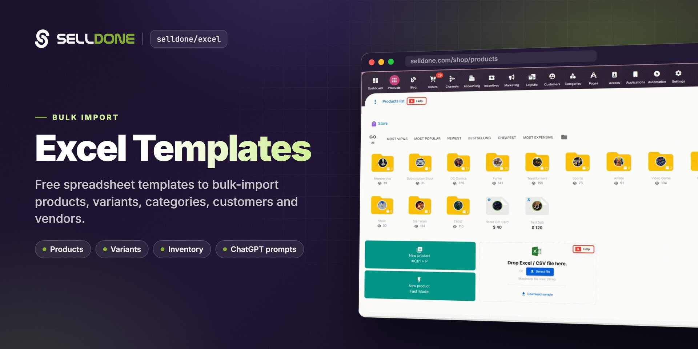
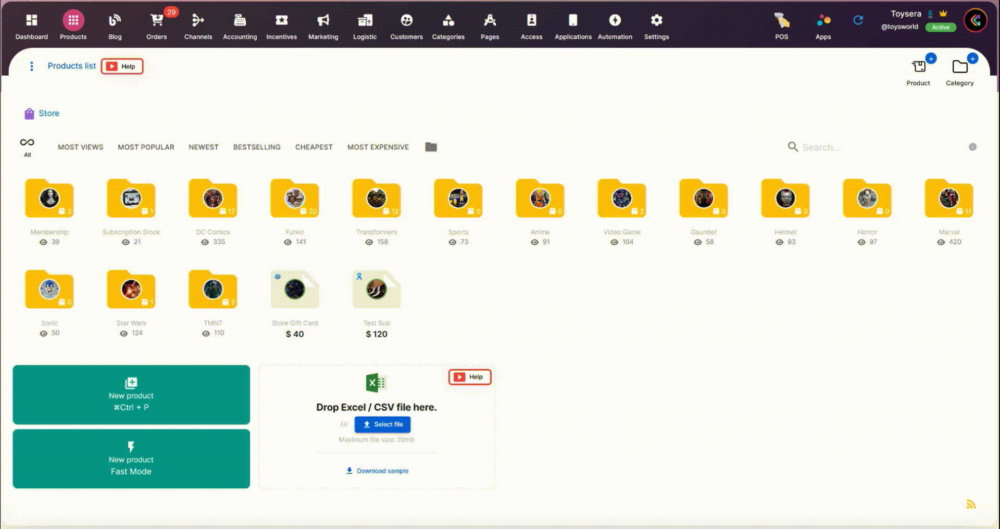

  

  
  
  

  <b>Free Excel templates for bulk importing products, inventory, categories, customers and vendors into Selldone shops.</b> 
  <a href="https://github.com/selldone/excel/wiki">Documentation</a> ·
  <a href="#quick-start">Quick start</a> ·
  <a href="https://github.com/selldone">Ecosystem</a> ·
  <a href="https://selldone.com">Selldone.com</a> ·
  <a href="https://github.com/selldone/excel/issues">Report an issue</a>

  <a href="https://github.com/selldone/storefront">Storefront</a> ·
  <a href="https://github.com/selldone/pagebuilder">Page Builder</a> ·
  <a href="https://github.com/selldone/components">Components</a> ·
  <a href="https://github.com/selldone/storefront-sdk">Storefront SDK</a> ·
  <a href="https://github.com/selldone/backoffice-sdk">Backoffice SDK</a> ·
  <a href="https://github.com/selldone/vendor-sdk">Vendor SDK</a> ·
  <a href="https://github.com/selldone/community-sdk">Community SDK</a> ·
  <a href="https://github.com/selldone/core">Core</a> ·
  <a href="https://github.com/selldone/cli">CLI</a> ·
  <a href="https://github.com/selldone/translate">Translate</a>

## Overview

Managing an online store can be a daunting task, especially when it comes to adding and updating a large number of
products. This repository is a free collection of Excel template files that simplifies bulk uploads to shops on
**Selldone® Business OS**.

The templates have clearly labeled columns for product details such as title, description, price, SKU and more, so
you can organize your catalog in a spreadsheet, then upload the file to your shop. Products are added or updated
automatically. Templates are also included for inventory and price updates, categories, customers and marketplace
vendors, plus a Shopify conversion guide and a ready-to-use ChatGPT prompt that converts any product spreadsheet to the
Selldone format.

Use these templates if you are a merchant migrating a catalog, an agency onboarding a new shop, or a developer who
wants to understand the Selldone import format.

## Key features

- **Product templates** — simple products, products with variants, and wholesale products with tiered prices.
- **Complete column reference** — every product column with its description, whether it is required and how it relates to other columns.
- **Variants in rows** — a row with **Type** `VARIANT` adds a variant to the product above it.
- **Create or update** — fill **Product ID** / **Variant ID** to update existing items; leave them empty to create new ones.
- **Tiered pricing** — up to ten **Qty X** / **Price X** levels for bulk discounts.
- **Inventory updates** — update stock and prices by SKU, or use the full inventory sheet.
- **Categories, customers and vendors** — dedicated templates for each.
- **Shopify migration** — a column mapping from Shopify's product export to Selldone.
- **ChatGPT prompt** — paste one prompt to convert any spreadsheet into the Selldone product format.

## Screenshots

YouTube tutorial: [How to Bulk Import Products into Selldone](https://youtu.be/fREaoivgq0g)

## Quick start

1. **Download a template.** For simple products, start with
   [`Products/products-import-no-variants-small.xlsx`](Products/products-import-no-variants-small.xlsx).
2. **Fill in your data.** Keep the header row. Follow the [column reference](#product-import-columns).
3. **Save the file** as `.xlsx`.
4. **Upload it to your shop.** In your Selldone shop dashboard, go to **Products** and drop the file on the page using
   the **Drag & Drop** feature.
5. **Review and confirm.** Check the imported data and confirm the import.

Tip: start with a small batch of products to get familiar with the process.

## Usage

### Templates at a glance

| Folder | File | Use it to |
|---|---|---|
| [Products](Products) | [`products-import-no-variants-small.xlsx`](Products/products-import-no-variants-small.xlsx) | Import simple products that do not have variants. |
| [Products](Products) | [`products-import-variants-full.xlsx`](Products/products-import-variants-full.xlsx) | Import products with variants (sizes, colors, styles and other attributes), with all detail columns. |
| [Products](Products) | [`products-import-wholesaler.xlsx`](Products/products-import-wholesaler.xlsx) | Import wholesale catalogs with price labels, units, order limits and tiered pricing. |
| [Products/Shopify](Products/Shopify) | [`Wholesale with tiered prices.xlsx`](Products/Shopify/Wholesale%20with%20tiered%20prices.xlsx) / [`.csv`](Products/Shopify/Wholesale%20with%20tiered%20prices.csv) | Convert a Shopify product export, including tiered prices. [Guide](Products/Shopify/readme.md). |
| [ChatGPT](ChatGPT) | [`README.md`](ChatGPT/README.md) | Copy a prompt that converts any product spreadsheet to the Selldone format. |
| [Inventory Update](Inventory%20Update) | [`SKU_QUANTITY.xlsx`](Inventory%20Update/SKU_QUANTITY.xlsx) | Update stock quantities by SKU. |
| [Inventory Update](Inventory%20Update) | [`SKU_PRICE.xlsx`](Inventory%20Update/SKU_PRICE.xlsx) | Update prices and discounts by SKU. |
| [Inventory Update](Inventory%20Update) | [`SKU_QUANTITY_PRICE.xlsx`](Inventory%20Update/SKU_QUANTITY_PRICE.xlsx) | Update quantities, prices and discounts by SKU. |
| [Inventory Update](Inventory%20Update) | [`FULL.xlsx`](Inventory%20Update/FULL.xlsx) | Update the full inventory sheet (products and variants). |
| [Category](Category) | [`categories.xlsx`](Category/categories.xlsx) | Import categories and their parent/child structure. |
| [Customers](Customers) | [`customers-import.xlsx`](Customers/customers-import.xlsx) | Import customers with level, segments and address. |
| [Vendors Import](Vendors%20Import) | [`vendors-import.xlsx`](Vendors%20Import/vendors-import.xlsx) | Import marketplace vendors with contact, bank and business details. |

### Product import columns

To import products into Selldone with an Excel file, format your spreadsheet according to the following structure. The
table lists every column, its description, whether it is required, its relations to other columns, and additional
notes.

| **Column Name** | **Description** | **Required** | **Relations/Notes** |
|---|---|---|---|
| **Product ID** | The unique identifier of the product in Selldone. | Optional | Used to update an existing product. If empty, a new product will be created. |
| **Variant ID** | The unique identifier of the product variant. | Optional | Used to update an existing variant. Applicable when **Type** is 'VARIANT'. |
| **Title** | The name of the product. | **Required** | |
| **Title En** | The English name of the product. | Optional | The standard name or technical name of the product in English. |
| **Type** | The type of the product. It can be `PHYSICAL`, `VIRTUAL`, `FILE`, `SERVICE`, `SUBSCRIPTION`. Use 'VARIANT' for variants; otherwise, use a valid product type. | **Required** | 'VARIANT' indicates the row is a variant of the last product listed. |
| **Price** | The price of the product as a floating-point number, e.g., `10.99`. | **Required** | Customer Price = `Price` + `Commission` - `Discount` |
| **Currency** | The currency code of the price, e.g., 'USD', 'EUR', 'GBP'. | **Required** | |
| **Commission** | The commission amount or percentage for the product. | Optional | Defaults to `0` if not provided. |
| **Discount** | The discount amount or percentage applied to the product. | Optional | Defaults to `0` if not provided. |
| **Discount Start Date** | The start date of the discount period. | Optional | Format: `YYYY-MM-DD` or `YYYY-MM-DD HH:MM:SS`. |
| **Discount End Date** | The end date of the discount period. | Optional | Format: `YYYY-MM-DD` or `YYYY-MM-DD HH:MM:SS`. |
| **Status** | The availability status of the product, e.g., 'Open', 'Close'. | **Required** | 'Open' means available for sale; 'Close' means not available. |
| **Quantity** | The available stock quantity. | Optional | Defaults to `0` if not provided. |
| **SKU** | The Stock Keeping Unit identifier. A unique code used to track inventory. | Optional | |
| **MPN** | The Manufacturer Part Number. | Optional | |
| **GTIN** | The Global Trade Item Number. | Optional | |
| **GPC** | The Global Product Classification code. | Optional | |
| **Condition** | The condition of the product, e.g., 'New', 'Used', 'Refurbished'. | Optional | |
| **Brand** | The brand or manufacturer of the product. | Optional | |
| **Warranty** | Warranty information, e.g., '1 Year Manufacturer Warranty'. | Optional | |
| **Spec** | Specifications of the product in JSON format. | Optional | Must be valid JSON (e.g., `{"Color":"Red","Size":"M"}`). |
| **Spec Order** | The display order of specifications in a JSON array. | Optional | Must be a valid array of `Spec` keys (e.g., `["Color","Size"]`). |
| **Pros** | Advantages of the product in JSON format. | Optional | Must be a valid JSON array (e.g., `["Lightweight","Durable"]`). |
| **Cons** | Disadvantages of the product in JSON format. | Optional | Must be a valid JSON array (e.g., `["Limited color options"]`). |
| **Image** | The main image URL of the product. | **Required** | |
| **Outputs** | Output specifications in JSON format. | Optional | Must be valid JSON. |
| **Inputs** | Input specifications in JSON format. | Optional | Must be valid JSON. |
| **Content Title** | Title of the product description content. | Optional | |
| **Content Body (Html)** | HTML content describing the product in detail. | Optional | |
| **Content Description** | A brief description of the product content. | Optional | |
| **Content Image** | URL of an image used in the content. | Optional | |
| **Content FAQ** | Frequently Asked Questions in JSON format. | Optional | Must be a valid JSON array. |
| **Content Structure Data** | Structured data for SEO in JSON-LD format. | Optional | Must be valid JSON-LD. |
| **Category** | The product category or categories. | Optional | Should match existing categories in your Selldone account; otherwise, it will create the category automatically. |
| **Lead Time** | The number of days before the product is shipped (production or handling time). | Optional | Defaults to `-1` if not provided. `-1` indicates no lead time. |
| **Extra** | Additional product details in JSON format, such as dimensions or weight. | Optional | Must be valid JSON (e.g., `{"weight":50,"width":100,"length":200,"height":40}`). |
| **Image Contain** | Indicates if the image should be contained within its container. | Optional | Accepts `TRUE` or `FALSE`. Defaults to `FALSE`. |
| **Return Warranty** | The return warranty period in days. | Optional | Defaults to `0` if not provided. |
| **Original** | Indicates if the product is original or a replica. | Optional | Accepts `TRUE` or `FALSE`. Defaults to `TRUE`. |
| **Slug** | The URL-friendly version of the product name. | Optional | If empty, it will be auto-generated from the **Title**. |
| **Images** | Additional image URLs for the product, separated by commas. | Optional | |
| **V_Color** | Variant attribute: color. | Optional | Applicable when **Type** is 'VARIANT'. |
| **V_Style** | Variant attribute: style. | Optional | Applicable when **Type** is 'VARIANT'. |
| **V_Volume** | Variant attribute: volume. | Optional | Applicable when **Type** is 'VARIANT'. |
| **V_Weight** | Variant attribute: weight. | Optional | Applicable when **Type** is 'VARIANT'. |
| **V_Pack** | Variant attribute: pack size or packaging. | Optional | Applicable when **Type** is 'VARIANT'. |
| **V_Type** | Variant attribute: type or model. | Optional | Applicable when **Type** is 'VARIANT'. |
| **Limit Min** | The minimum quantity allowed per order. | Optional | Defaults to `0` (no minimum limit). |
| **Limit Max** | The maximum quantity allowed per order. | Optional | Defaults to `0` (no maximum limit). Must be greater than or equal to **Limit Min** if provided. |
| **Qty 1** | Minimum quantity for tiered pricing level 1. | Optional | Used in conjunction with **Price 1** for bulk pricing. |
| **Price 1** | Price for tiered pricing level 1. | Optional | |
| **Qty 2** | Minimum quantity for tiered pricing level 2. | Optional | |
| **Price 2** | Price for tiered pricing level 2. | Optional | |
| **Qty 3** | Minimum quantity for tiered pricing level 3. | Optional | |
| **Price 3** | Price for tiered pricing level 3. | Optional | |
| **Qty 4** | Minimum quantity for tiered pricing level 4. | Optional | |
| **Price 4** | Price for tiered pricing level 4. | Optional | |
| **Qty 5** | Minimum quantity for tiered pricing level 5. | Optional | |
| **Price 5** | Price for tiered pricing level 5. | Optional | |
| **Qty 6** | Minimum quantity for tiered pricing level 6. | Optional | |
| **Price 6** | Price for tiered pricing level 6. | Optional | |
| **Qty 7** | Minimum quantity for tiered pricing level 7. | Optional | |
| **Price 7** | Price for tiered pricing level 7. | Optional | |
| **Qty 8** | Minimum quantity for tiered pricing level 8. | Optional | |
| **Price 8** | Price for tiered pricing level 8. | Optional | |
| **Qty 9** | Minimum quantity for tiered pricing level 9. | Optional | |
| **Price 9** | Price for tiered pricing level 9. | Optional | |
| **Qty 10** | Minimum quantity for tiered pricing level 10. | Optional | |
| **Price 10** | Price for tiered pricing level 10. | Optional | |
| **Price Label** | A label or description for the price, e.g., 'per unit', 'per kg'. | Optional | |
| **Unit** | The unit of measurement for the product, e.g., 'kg', 'liters', 'pcs'. | Optional | |
| **Price Input** | Indicates the type of price input, e.g., 'DEFAULT', 'CUSTOM'. | Optional | Use predefined constants or values accepted by Selldone. |
| **Valuation ID** | The ID of the valuation method associated with the product. | Optional | Must correspond to a valid valuation ID in your Selldone account. |

The variant and wholesaler templates also contain the columns **Visits**, **Rate**, **Rates Count**,
**For Available**, **For Auction**, **Sells** and **Create Date**. They are not part of the import reference above,
and the [ChatGPT prompt](ChatGPT/README.md) treats columns such as **Visits** and **Rate** as unsupported.

### Notes and guidelines

- **First Row**: Represents a product with detailed information.
- **Second Row**: Represents a variant of the product above.
- Fields like **Spec**, **Spec Order**, **Pros**, **Cons**, **Extra**, and **Content Body (Html)** contain JSON or HTML
  data. Ensure that these are properly formatted in your Excel file.
- The **Images** field contains multiple image URLs separated by commas.
- **Boolean Fields** like **Image Contain** and **Original** should be either `TRUE` or `FALSE`.
- **Date Fields** should be in the format `YYYY-MM-DD HH:MM:SS`.
- **JSON Fields**: Columns like **Spec**, **Pros**, **Cons**, **Outputs**, **Inputs**, **Content FAQ**, and **Content
  Structure Data** must contain valid JSON strings.
- **Date Formats**: Use the `YYYY-MM-DD` format for all date fields to ensure proper parsing.
- **Boolean Fields**: For fields like **Image Contain** and **Original**, use `true` or `false`.
- **Numeric Fields**: Ensure numeric fields like **Price**, **Commission**, **Discount**, **Quantity**, **Return
  Warranty**, **Limit Min**, and **Limit Max** contain valid numbers.
- **Variant Rows**: When **Type** is 'VARIANT', the row represents a variant of the last product defined in the
  spreadsheet. All variant attributes (**V_Color**, **V_Style**, etc.) are applicable in this case.
- **Tiered Pricing**: To offer bulk pricing, use **Qty X** and **Price X** columns. For example, if **Qty 1** is `10`
  and **Price 1** is `9.99`, customers buying 10 or more units get the product at $9.99 each.
- **Images**: Multiple image URLs in the **Images** column should be separated by commas without spaces.
- **Categories and Brands**: Ensure that the values provided for **Category** and **Brand** match exactly with those
  defined in your Selldone account to prevent mismatches.
- **Updating Products**: If you provide a **Product ID** (and **Variant ID** for variants), the system will attempt to
  update the existing product or variant. If these are left empty, new entries will be created.
- **Limits**: If **Limit Max** is provided, it must be greater than **Limit Min**. If **Limit Max** is `0`, it signifies
  no maximum limit.

### Example row

Show an example product row

Here's an example of how a row might look in your Excel file:

| Field | Value |
|---|---|
| **Product ID** | |
| **Title** | Blue and green leather office sofa |
| **Title En** | |
| **Type** | PHYSICAL |
| **Price** | 860 |
| **Currency** | GBP |
| **Commission** | |
| **Discount** | 45 |
| **Discount Start Date** | 2019-10-02 14:47:27 |
| **Discount End Date** | 2019-10-31 14:47:00 |
| **Status** | Open |
| **Quantity** | 373 |
| **SKU** | SXD-45122312 |
| **MPN** | WS512354 |
| **GTIN** | |
| **GPC** | 4986 |
| **Condition** | new |
| **Brand** | J&J |
| **Warranty** | 1 year warranty |
| **Spec** | `{"Specifications":"group","Brand":["J&J"],"Manufacturer":["Sunny Way"],"Additional Details & Dimensions":"group","Seat":["29'' H x 65.7'' W x 23.5'' D"],"Overall":["42.7'' H x 90.3'' W x 41.5'' D"],"Arm Height - Floor to Arm":["28''"],"Back Height - Seat to Top of Back":["19.1''"],"Leg Height - Top to Bottom":["4''"],"Minimum Door Width - Side to Side":["13.7''"],"Overall Product Weight":["80 Kg"],"Leg Material":["Plastic"],"Cushion Construction":["Foam"],"Design":["Luxury"],"Weight Capacity":["500 Kg"],"Adult Assembly Required":["Yes"]} ` |
| **Spec Order** | `["Specifications","Brand","Manufacturer","Additional Details & Dimensions","Seat","Overall","Arm Height - Floor to Arm","Back Height - Seat to Top of Back","Leg Height - Top to Bottom","Minimum Door Width - Side to Side","Overall Product Weight","Leg Material","Cushion Construction","Design","Weight Capacity","Adult Assembly Required"]` |
| **Pros** | {"Removable legs":"Yes"} |
| **Cons** | |
| **Image** | https://cdn.selldone.com/app/shops/82/products/ajpg34b8447539e48aad6f52ba8e12642683.jpg |
| **Outputs** | |
| **Inputs** | |
| **Content Title** | About This Sofa |
| **Content Body (Html)** | `
The couch is a three-seater choice in this adaptable stationery set that is intended to match your space and style. Built to last, the blends form, function, and simplicity of installation for an eclectic lifestyle. The sofa's design lines and size add a modern touch to places large and small with equal elegance. High-density foam cushions and curved arms embrace your body and are guaranteed to become your favorite place to unwind after a long day. With quality upholstery fabric and a sturdy eucalyptus timber frame, this long-lasting plush couch encourages you to relax in the confidence that you will be able to enjoy it for many years to come.

<figure contenteditable='false'></figure>

 
<h4>Product Spec</h4><ul><li>Pocket coil coil type</li><li>Capacity in Kg: 500 Kg.</li><li>No stain resistance.</li><li>Arms are made of plastic.</li><li>Cushion Material: Leather</li><li>Design: Normal</li><li>Yes, adult assembly is required.</li></ul>
This 76\" wide sofa adds a modern look to your space with its streamlined silhouette and square arms. It has a frame made from engineered wood with tapered legs in a rich brown hue that matches well with various styles and color options.
<blockquote>
This couch features faux leather upholstery with a foam fill for additional support as you hang out with friends to watch TV or chat for a few hours.
</blockquote>
` |
| **Content Description** | The couch is a three-seater choice in this adaptable stationery set that is intended to match your space and style. Built to last, the blends form, function, and simplicity of installation for an eclectic lifestyle. |
| **Content Image** | https://cdn.selldone.com/app/shops/82/articles/ajpgcf361327878f68fce259f904eccf6cf1.jpg |
| **Content FAQ** | |
| **Content Structure Data** | |
| **Category** | living-room-furniture-1 |
| **Lead Time** | 50 |
| **Extra** | `{"weight":50,"width":100,"length":200,"height":40} ` |
| **Image Contain** | TRUE |
| **Visits** | 115 |
| **Rate** | 4.8 |
| **Rates Count** | 1 |
| **For Available** | |
| **For Auction** | |
| **Sells** | 6 |
| **Return Warranty** | |
| **Original** | TRUE |
| **Slug** | blue-and-green-leather-office-sofa |
| **Create Date** | 2019-10-02 14:31:23 |
| **Images** | https://cdn.selldone.com/app/shops/82/products/bjpg0a99ccef8e6412c877d4abd2f4b11d33.jpg, https://cdn.selldone.com/app/shops/82/products/cjpg88323af4e0ca062743dca17446f4e655.jpg |
| **V_Color** | #0097A7 |
| **V_Style** | |
| **V_Volume** | |
| **V_Weight** | |
| **V_Pack** | |
| **V_Type** | |

**Note**: Adjust the values according to your actual product data.

### How to use the product templates

1. **Download the template**: Click on the link of the template that best suits your needs to download the Excel file.
2. **Fill in your product data**: Open the Excel file and fill in your product information, following the column
   structure and guidelines provided.
3. **Save the file**: Once you've added all your products, save the Excel file on your computer.
4. **Import into Selldone**:
   - Go to your Selldone shop dashboard.
   - Navigate to the **Products** section.
   - Use the **Drag & Drop** feature to upload your Excel file.
5. **Review and confirm**: After uploading, review the imported data for accuracy and confirm the import.

Tips:

- **Back up your data**: Always keep a backup of your Excel file in case you need to reference or re-import your
  product data.
- **Validate data formats**: Ensure that all date, numeric, and JSON fields are correctly formatted to prevent import
  errors.
- **Start small**: If you're new to bulk importing, start with a small batch of products to get familiar with the
  process.

### Convert an existing file

- **With ChatGPT:** attach your file in ChatGPT and paste the prompt from [`ChatGPT/README.md`](ChatGPT/README.md). It
  maps your columns to the Selldone columns, fixes value formats (numeric prices, currency codes, `Open`/`Close`,
  `TRUE`/`FALSE`, dates, JSON) and lists missing required fields.
- **From Shopify:** follow the [Shopify guide](Products/Shopify/readme.md). It maps Shopify export columns
  (for example **Published** → **Status**, **Variant SKU** → **SKU**, **Variant Price** → **Price**,
  **Image Src** → **Image**) and explains tiered pricing with **Qty 1–6** / **Price 1–6**.

Details: [Converting Existing Files](https://github.com/selldone/excel/wiki/Converting-Existing-Files) in the wiki.

### Inventory update templates

| File | Columns |
|---|---|
| [`SKU_QUANTITY.xlsx`](Inventory%20Update/SKU_QUANTITY.xlsx) | SKU, Quantity |
| [`SKU_PRICE.xlsx`](Inventory%20Update/SKU_PRICE.xlsx) | SKU, Price, Currency, Commission, Discount, Discount Start Date, Discount End Date |
| [`SKU_QUANTITY_PRICE.xlsx`](Inventory%20Update/SKU_QUANTITY_PRICE.xlsx) | SKU, Price, Quantity, Currency, Commission, Discount, Discount Start Date, Discount End Date |
| [`FULL.xlsx`](Inventory%20Update/FULL.xlsx) | Product ID, Variant ID, Title, Type, Price, Currency, Commission, Discount, Discount Start Date, Discount End Date, Quantity, SKU, MPN, Create Date, V_Color, V_Style, V_Volume, V_Weight, V_Pack, V_Type |

The column meanings match the [product import columns](#product-import-columns). See
[Inventory Update](https://github.com/selldone/excel/wiki/Inventory-Update) in the wiki.

### Category template

[`Category/categories.xlsx`](Category/categories.xlsx) columns: **Name**, **Title**, **Description**, **Image**,
**Parent**. In the sample, `category_2` sets **Parent** to `category_1`, the **Name** of another category, to build a
subcategory. See [Category Import](https://github.com/selldone/excel/wiki/Category-Import).

### Customer template

[`Customers/customers-import.xlsx`](Customers/customers-import.xlsx) columns: **Name**, **Phone**, **Email**,
**Level**, **Segments**, **Birthday**, **Sex**, **Currency**, **Country**, **State**, **City**, **Address**, **No**,
**Unit**, **Postal**, **Message**, **Address Phone**, **Address Name**, **Lat**, **Lng**. The sample uses `BRONZE` for
**Level**, `VIP,Local` for **Segments**, `Male`/`Female` for **Sex**, `USD` for **Currency** and `US` for **Country**.
See [Customer Import](https://github.com/selldone/excel/wiki/Customer-Import).

### Vendor template

[`Vendors Import/vendors-import.xlsx`](Vendors%20Import/vendors-import.xlsx) columns: **Name**, **Description**,
**Enable**, **Access**, **Email**, **Address**, **Web**, **Tel**, **Icon**, **Bank**, **Bank Account Name**,
**Bank Account Number**, **Bank Routing Number**, **IBAN**, **Swift**, **Bank Address**, **Country**, **State**,
**Business**, **Business Name**, **Tax ID**. See [Vendor Import](https://github.com/selldone/excel/wiki/Vendor-Import).

## Documentation

| Page | What you'll learn |
|---|---|
| [Home](https://github.com/selldone/excel/wiki) | What the templates are and which one to pick. |
| [Getting Started](https://github.com/selldone/excel/wiki/Getting-Started) | Download, fill and upload your first file. |
| [Product Import](https://github.com/selldone/excel/wiki/Product-Import) | Every product column, variants, tiered pricing and a full example row. |
| [Converting Existing Files](https://github.com/selldone/excel/wiki/Converting-Existing-Files) | Convert Shopify exports and other spreadsheets (ChatGPT prompt). |
| [Inventory Update](https://github.com/selldone/excel/wiki/Inventory-Update) | Update stock and prices in bulk. |
| [Category Import](https://github.com/selldone/excel/wiki/Category-Import) | Import categories and subcategories. |
| [Customer Import](https://github.com/selldone/excel/wiki/Customer-Import) | Import customers with levels, segments and addresses. |
| [Vendor Import](https://github.com/selldone/excel/wiki/Vendor-Import) | Import marketplace vendors. |
| [FAQ](https://github.com/selldone/excel/wiki/FAQ) | Common questions and import errors. |

## How it fits in the ecosystem

The templates are the no-code way to load data into a Selldone shop. The same data can then be read through the
[Backoffice SDK](https://github.com/selldone/backoffice-sdk), synced to an ERP with the
[ERP guide](https://github.com/selldone/erp), or copied to your own database with
[Clone Sheet](https://github.com/selldone/clone-sheet).

### Related projects

| Project | Why it matters here |
|---|---|
| [Backoffice SDK](https://github.com/selldone/backoffice-sdk) | Create and update products, categories and more from code instead of spreadsheets. |
| [ERP](https://github.com/selldone/erp) | Guide and demos to connect ERP software to Selldone shops. |
| [Clone Sheet](https://github.com/selldone/clone-sheet) | Clone shop data into MariaDB/MySQL. |
| [GPT](https://github.com/selldone/gpt) | Schema and guide to build a custom GPT for Selldone. |
| [Core](https://github.com/selldone/core) | Shared models, types, enums and helpers. |

## Contributing

Contributions are welcome, for example new templates or corrections to the column reference. Please read the
organization [contributing guide](https://github.com/selldone/.github/blob/main/CONTRIBUTING.md) and
[code of conduct](https://github.com/selldone/.github/blob/main/CODE_OF_CONDUCT.md). Keep header names exactly as they
appear in the existing templates.

## Security

Please do not report security vulnerabilities in public issues. Follow the
[Selldone security policy](https://github.com/selldone/.github/blob/main/SECURITY.md) and email
[security@selldone.com](mailto:security@selldone.com).

## License

This repository is licensed under the GNU General Public License v3.0. See the [LICENSE](LICENSE) file for the full text.

---

Part of the <a href="https://github.com/selldone">Selldone® Business OS</a> open-source ecosystem · <a href="https://selldone.com">selldone.com</a>

